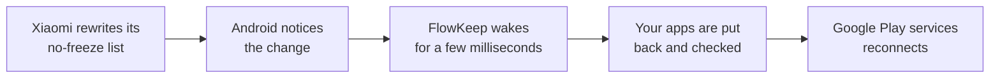
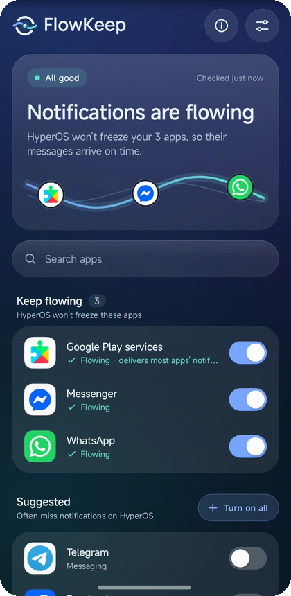
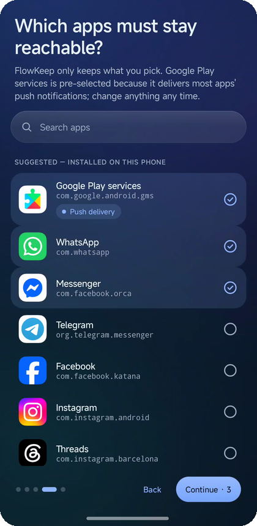
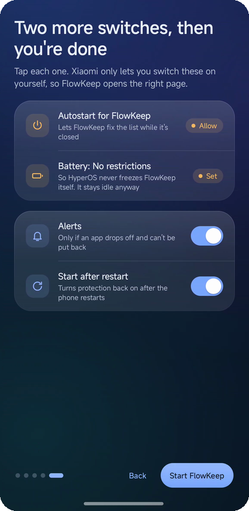

  

<h1 align="center">FlowKeep</h1>

  <b>Let notifications flow.</b> 
  Keeps WhatsApp, Messenger, Gmail and your other important apps delivering notifications on time on Xiaomi HyperOS.

  
  
  
  
  

  <a href="https://github.com/adnansiddiqui-dev/FlowKeep/releases/latest"><b>⬇&nbsp; Download the latest APK</b></a>
  &nbsp;·&nbsp; <a href="#set-up-in-one-minute">Set‑up guide</a>
  &nbsp;·&nbsp; <a href="#faq">FAQ</a>

---

## ▶ Watch: set up in one minute

https://github.com/user-attachments/assets/7f266b69-382d-4c38-b627-3f94720d9f70

A real recording of the first-time setup on HyperOS 4, with taps and narration (76 s). Recorded with
version 1.0: since 1.2 you choose your apps on the home screen after setup. 
Turn the sound on for the spoken guide. Can't play it here? <a href="assets/flowkeep-setup.mp4">Open the video file</a>.

---

## Why your notifications are late

To save battery, HyperOS **freezes apps you aren't using**. A frozen app can't receive anything, so
its messages pile up until you open it.

Xiaomi keeps a hidden list of apps it never freezes, but it **rewrites that list now and then**
(when you install apps or change battery settings) and drops anything it didn't choose.
**Google Play services**, which delivers the notifications for most apps, has no switch to stay
on that list at all.

> The result: WhatsApp, Messenger, Gmail and others often deliver notifications late, or only
> when you unlock the phone.

## What FlowKeep does

| | |
|---|---|
| 🔁 **Keeps your apps listed** | Turn an app on and FlowKeep adds it to Xiaomi's no-freeze list, Google Play services included. |
| ⚡ **Fixes it within seconds** | When Xiaomi removes an app, FlowKeep puts it back in about two seconds and asks Google Play services to reconnect. |
| 🧭 **Guides the rest** | If an app's Xiaomi *Autostart* is off, or its battery is on *No restrictions* (extra battery for nothing, once FlowKeep stops the freezing), FlowKeep shows exactly what to change and keeps a reminder until it's done. |
| ✨ **Suggests apps** | Popular apps that often miss notifications (chat, social, email, work) are suggested, only the ones you have installed. |
| 🔋 **Uses almost no battery** | Nothing runs until Xiaomi changes its list. [Measured numbers](docs/BATTERY.md). |
| ⬆️ **Updates itself** | FlowKeep checks GitHub for a new version once a day while it's open. Tap **Update** and confirm in Android's installer. |
| 🔒 **Private by design** | No ads, no analytics, no account. It goes online only to check for its own updates (you can turn that off). No root, no second app, no Developer options. |

## How it works

FlowKeep doesn't poll or keep anything running. Android itself watches the list and wakes FlowKeep
only when it changes.

## Screenshots

  
  &nbsp;
  
  &nbsp;
  

## Requirements

- A **Xiaomi, Redmi or POCO** phone with **HyperOS**, on **Android 12 or newer**.
- Tested on a Redmi K90 with HyperOS 4 (China ROM, Android 17). Other models and HyperOS versions
  should work the same way but aren't confirmed yet; [reports are welcome](#feedback).

## Set up in one minute

1. **Download** `FlowKeep-….apk` from [Releases](https://github.com/adnansiddiqui-dev/FlowKeep/releases/latest)
   on your phone and open it. Allow installing from your browser if asked.
2. **Open FlowKeep.** Xiaomi first shows its own **Review permissions** list. Only the first two
   matter:
   - ✅ **Access list of installed apps**: so you can choose your apps.
   - ✅ **Modify system settings**: so FlowKeep can edit Xiaomi's no-freeze list.

   Leave everything else off and tap **OK**. If you land on the home screen, open FlowKeep again.
   (Missed one? FlowKeep asks for it and waits until it's on.)
3. **Get started** and read the two short pages.
4. **Two switches** for FlowKeep itself, each opening the right Xiaomi page. Both are required;
   each row turns to *Done* when you come back:
   - **Autostart for FlowKeep**: switch it on and confirm.
   - **Battery: No restrictions**: choose *No restrictions*. FlowKeep is the only app that needs
     this; your other apps stay on *Battery saver*.
5. Tap **Start FlowKeep**, then **choose your apps** on the home screen: start with **Google Play
   services** (suggested first), then WhatsApp, Messenger, your mail app and so on. Nothing is
   turned on until you choose it.

**Updating:** when a new version is out, Home shows *Update available*. Tap **Update**, then confirm
in Xiaomi's installer ([steps](docs/USER_GUIDE.md#updating-flowkeep)). Installing a newer APK over the
old one works too. Your apps, settings and permissions stay.

Full walkthrough: [User guide](docs/USER_GUIDE.md).

## FAQ

<b>Is it safe? What can FlowKeep change?</b>

FlowKeep changes exactly one Xiaomi setting: its list of apps that are never frozen. It keeps every
entry Xiaomi put there, re-reads the setting after each change, and backs up the original value.
It goes online only to ask GitHub for its own newest version, and sends nothing about you or your
phone. See [Permissions & privacy](docs/PERMISSIONS.md).

<b>Why does Xiaomi show a long permission list on first launch?</b>

That screen is Xiaomi's, not FlowKeep's. To edit Xiaomi's list without root, FlowKeep has to be
built for an older Android version, and HyperOS shows that review screen for such apps, listing
its standard controls. Only the first two switches matter; leave the rest off.

<b>Does it drain the battery?</b>

No. Nothing runs between changes. In a 10-minute screen-off test FlowKeep used no measurable CPU of
its own, and a repair takes a few milliseconds. Details: [Battery & performance](docs/BATTERY.md).

<b>Do I need root, Shizuku or Developer options?</b>

No. FlowKeep is a single app. It only needs the two permissions above plus Autostart and
"No restrictions" for itself, all set from normal settings pages.

<b>What is Autostart and why does FlowKeep ask about it?</b>

Xiaomi's Autostart lets an app wake up after it was closed. FlowKeep needs it for itself, and your
chat apps need it to wake for new messages. Xiaomi only lets you switch it on yourself, so FlowKeep
opens the right page and warns you while it's off.

<b>Should I set my apps to "No restrictions" too?</b>

No, only FlowKeep needs it. *No restrictions* also lets an app skip Android's Doze and run freely
in the background, which costs battery. FlowKeep already keeps your apps off HyperOS's freezer,
so the recommended *Battery saver* is enough. If an app you keep is on *No restrictions*,
FlowKeep shows a *Save battery* tip and opens that app's battery page. Xiaomi doesn't let other
apps change this setting, so you pick *Battery saver (recommended)* yourself; it takes one tap.

<b>Some notifications are still late at night. Why?</b>

Being on Xiaomi's list stops HyperOS's routine freezing. HyperOS has a few other limits, such as
deep sleep at night, that no app can change. FlowKeep makes late notifications much rarer, but it
can't promise every single one is instant.

<b>Will it work on Samsung, Pixel or a global Xiaomi ROM?</b>

FlowKeep is for Xiaomi HyperOS, where this freezing happens. Other brands don't have Xiaomi's list,
and stock Android 14+ refuses to install apps built the way FlowKeep must be. Global HyperOS ROMs
haven't been tested yet; if installation is blocked, please open an issue.

<b>How do updates work?</b>

Once a day, while FlowKeep is open, it asks this page for the newest version. When there is one,
Home shows *Update available*. Tap **Update** and **Install update**: FlowKeep downloads it from
here, checks it (size, checksum, and that it's signed by the same developer), and hands it to
Android's installer. Xiaomi's installer then asks you to confirm a few times; on China ROMs tick
*I understand…* before **Update**. You can turn automatic checks off in Settings → Updates.

<b>Why isn't it on Google Play?</b>

Google Play requires apps to target a recent Android version, which would prevent FlowKeep from
editing Xiaomi's list without root. So it's distributed here as an APK, signed with the same key
for every release, so updates install over the old version.

## Feedback

Found a bug, or have a phone it doesn't work on? Open an
[issue](https://github.com/adnansiddiqui-dev/FlowKeep/issues) with your phone model and HyperOS
version (Settings → About phone).

## Developer

Made by **Adnan Siddiqui** ·
[adnansiddiqui.dev](https://adnansiddiqui.dev) ·
[LinkedIn](https://www.linkedin.com/in/adnansiddiqui-dev/) ·
[Facebook](https://www.facebook.com/adnansiddiqui.dev)

---

FlowKeep is free to use. Its source code is not public. Xiaomi, Redmi, POCO, HyperOS and
Google Play are trademarks of their owners; FlowKeep is not affiliated with them.
